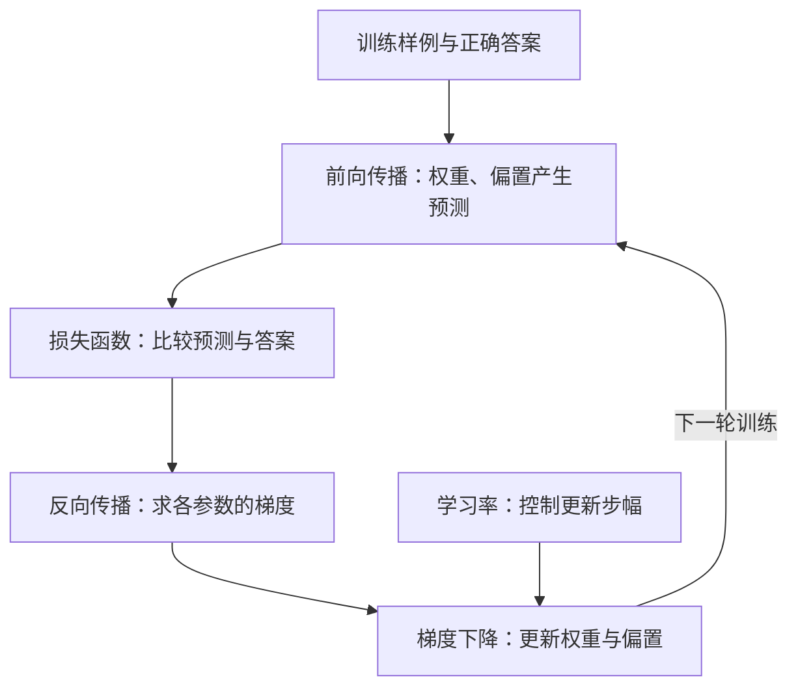

# AI: A Guide for Thinking Humans
## 章节抽查与 AI 里程碑手册

本手册围绕 Melanie Mitchell 的 *Artificial Intelligence: A Guide for Thinking Humans* 第 1、2、6、7、8 章组织，后半部分汇总书中其他章节的重要里程碑和案例。每道学生题后紧跟教师参考答案。

**双语使用说明 / Bilingual note：** 下文的英文关键句是便于课堂讲解的英文概括，与旁边的中文表达同一意思；它们不是原书的逐字引文。核心术语第一次出现及术语表均给出中文与英文。

## 四次章节抽查安排（每次 70 分钟）

学生已用约一个月详细阅读本书。以下四次课直接使用本讲义的概念说明、学生题目和书中案例；每道题后的参考答案用于反馈，不作为学生背诵材料。附录的 NOAI B 区补充考点暂不纳入这四次抽查。

| 次数 | 对应讲义内容 | 当堂核心任务 |
|---|---|---|
| 第 1 次 | 第 1 章概念、第 2 章训练流程图及两章学生题 | 比较 GPS 与感知机；解释损失、反向传播、梯度下降和学习率如何调整权重与偏置。 |
| 第 2 次 | 第 6 章学生题、全书里程碑表中的视觉与长尾案例 | 区分数据集内准确率、泛化和现实鲁棒性；用撒盐线、沙袋、背景捷径或对抗样本支持判断。 |
| 第 3 次 | 第 7 章概念与学生题、ACLU 人脸识别案例 | 分析群体偏差、不可解释性、隐私、复核和责任；给出具体应对措施。 |
| 第 4 次 | Rosie 的 Q-learning、第 8 章学生题、AlphaGo 延伸题 | 解释奖励如何影响较早动作、探索与利用；比较机器人与围棋任务的边界。 |

**每次 70 分钟的使用方式：** 10 分钟查看本次对应部分与书中证据；25 分钟独立回答对应学生题；20 分钟讲解、互相追问“这个例子说明什么、不能说明什么”；15 分钟根据讨论和教师反馈修订答案。里程碑表用于查找证据，不要求逐项记忆年份。

# 第一部分：按四次抽查学习

请按“方法或机制 - 书中例子 - 能说明什么 - 不能说明什么”作答。每章先看概念解释，再独立回答紧随其后的学生题。每道题后紧跟参考答案，课堂抽查时先遮住答案独立作答。

## 第 1 次：早期 AI 与神经网络（第 1、2 章）

### 第 1 章概念：四种思路

它们不是四个完全平行、互相排斥的类别。符号主义（symbolic AI）与次符号主义（subsymbolic AI）是两种 AI 表示路线；连接主义（connectionism）是次符号主义中受大脑启发的重要路线；行为主义（behaviorism）来自心理学，影响了人们对学习和反馈的理解。

**关键句 / Key statement：** 连接主义属于次符号主义的重要路线，行为主义则是关于学习的心理学观点。 / Connectionism is a major subsymbolic approach, whereas behaviorism is a psychological account of learning.

| 思路 | 关注什么 | 书中例子 | 关系与局限 |
|---|---|---|---|
| **符号主义（symbolic AI）** | 用人能读懂的符号表示概念，再用明确规则操作这些符号。 | General Problem Solver（GPS）：把状态、目标、操作和规则写清，再搜索“传教士与食人族”问题的解。 | 规则明确时容易追踪推理；规则之外的情况和常识难以穷举。 |
| **次符号主义（subsymbolic AI）** | 不把所有知识都写成人类可读规则，而通过数值计算和数据学习模式。 | 感知机（perceptron）、现代神经网络（neural networks）。 | 是与符号路线相对的宽泛说法；通常适合感知任务，但内部数值表示不容易解释。 |
| **连接主义（connectionism）** | 认为知识分布在许多处理单元及其带权连接中；受大脑神经连接启发。 | 感知机、多层神经网络，以及 1980 年代的 connectionist networks。 | 是次符号主义的一条主要路线，不是与次符号主义并列的另一大类。 |
| **行为主义（behaviorism）** | 研究行为怎样受环境、训练和奖惩影响，重视可观察的刺激、反应和条件作用。 | Skinner 用强化训练动物；Rosenblatt 借鉴条件作用，让感知机根据正确或错误反馈调整。 | 是心理学学习观，不是网络结构。监督学习（supervised learning）的反馈思想和强化学习（reinforcement learning）的奖励有历史联系，但不能把它们简单等同于行为主义。 |

**快速辨认：** 符号主义问“规则和概念怎样写出来”；次符号主义问“数值系统怎样从数据学出模式”；连接主义问“知识怎样分布在神经单元的连接中”；行为主义问“反馈和奖惩怎样改变行为”。

### 第 1 章：四种思路与早期 AI

区分符号主义、次符号主义、连接主义和行为主义。GPS 与感知机分别体现什么？行为主义的反馈观如何影响感知机学习？

**作答核心句 / Answer focus：** 四种思路不是四个互斥类别。 / The four approaches are not four mutually exclusive categories.

#### 参考答案

GPS 体现符号主义：人明确写出概念、状态、规则和操作，程序再搜索解法。感知机体现次符号主义和连接主义：它用数值权重表示输入连接的影响，并从例子中调整这些数值。连接主义是次符号 AI 的一种脑启发路线，不是与次符号主义并列的类别。行为主义是心理学关于行为受环境和反馈塑造的观点；Rosenblatt 借鉴 Skinner 的条件作用，把正确/错误反馈用于训练感知机。行为主义不是网络结构，监督学习与强化学习也不能简单等同于行为主义。GPS 规则清楚、推理较可读，但常识难穷举；单层感知机可学习，但能力受限。

**关键句 / Key statement：** GPS 依赖人写的符号与规则，感知机则从例子中调整连接权重。 / GPS relies on human-written symbols and rules; a perceptron adjusts connection weights from examples.

### 第 2 章概念：网络怎样训练

**关键句 / Key statement：** 损失函数衡量错误，反向传播计算梯度，梯度下降按学习率更新权重和偏置。 / The loss function measures error; backpropagation computes gradients; gradient descent updates weights and biases using the learning rate.

| 环节 | 它回答的问题 | 对权重和偏置做什么 |
|---|---|---|
| 损失函数（loss function） | 预测错了多少？ | 把预测与正确答案的差异汇总成可比较的数值。它衡量错误大小，但单独不告诉每个参数该往哪边改。 |
| 梯度（gradient） | 每个参数稍微改变时，损失会怎样变化？ | 为每个权重（weight）和偏置（bias parameter）提供局部的变化方向与幅度信息。梯度指向损失上升最快的方向。 |
| 反向传播（backpropagation） | 各层参数分别对错误有多大影响？ | 从输出层向前传递误差信息，计算每个权重和偏置对应的梯度。 |
| 梯度下降（gradient descent） | 怎样让损失往下降？ | 让参数朝梯度的反方向移动，使当前附近的损失减小。权重和偏置都会更新。 |
| 学习率（learning rate） | 每次移动多大一步？ | 控制每次参数更新的步幅；不决定方向，方向由梯度提供。 |

**一次训练循环：** 箭头表示先后顺序；学习率作用在参数更新这一步。

**怎样调整权重：** 如果某条连接的权重稍微变大就会让损失变大，梯度会记录这一局部关系，梯度下降就把该权重往相反方向调；如果变大能让损失下降，更新方向就相反。权重影响还取决于该连接上的输入信号强弱。

**怎样调整偏置：** 偏置也有自己的梯度和更新步幅。它整体移动一个神经元的判断基准，不依赖某个输入特征是否特别强；它和权重一样，按梯度指示的方向、由学习率控制步幅来更新。

**学习率大小的影响：** 太大时，参数可能越过低损失区域，训练震荡甚至发散；太小时，每次只移动一点，训练会很慢，也可能长时间停在不理想的位置。训练时观察损失和验证集表现，帮助选择或调整学习率。

**关系总览：** 损失函数衡量错多少；梯度描述损失对每个参数的敏感方向和幅度；反向传播负责计算梯度；梯度下降用梯度更新权重和偏置；学习率控制更新幅度。

### 第 2 章：网络怎样学会识别数字

多层神经网络怎样改进了单层感知机？请解释损失函数、梯度、反向传播、梯度下降和学习率怎样共同调整权重与偏置。为什么识别准确率提升不等于网络已经像人一样理解数字？

**作答核心句 / Answer focus：** 反向传播算梯度，梯度下降按学习率更新参数。 / Backpropagation computes gradients, and gradient descent updates parameters at a step size set by the learning rate.

#### 参考答案

多层网络增加隐藏层，能组合出更复杂的特征。损失函数把预测与正确答案的差异量化。梯度说明损失对每个权重和偏置在当前位置的变化方向与幅度。反向传播从输出往前计算这些梯度；梯度下降让参数朝损失下降的方向更新；学习率控制每次更新的步幅。太大可能越过低损失区域、震荡或发散；太小则训练缓慢。权重更新方向由它对应的梯度决定，偏置也有自己的梯度；权重影响还受该连接输入信号强弱影响。

书中的手写数字实验使用 60,000 个例子训练、10,000 个新例子测试：单层感知机约答对 80%，含 50 个隐藏单元的网络约 94%。这说明在该测试设置下网络表现更好，不证明它理解数字的含义；作者指出网络参数难以解释。

**关键句 / Key statement：** 更高的识别准确率不等于像人一样理解数字。 / Better recognition accuracy does not imply human-like understanding of digits.

## 第 2 次：准确率之外（第 6 章）

阅读本章题目时，利用第二部分里程碑表中的视觉识别、撒盐线、沙袋、背景捷径和对抗样本作证据；区分“测试集高分”“新情境泛化”“现实鲁棒性”。

### 第 6 章：图像识别的进步与局限

深度学习在图像识别上的进步，解决了早期方法的哪些困难？书中又用哪些例子说明它仍然会出错？

**作答核心句 / Answer focus：** 数据集内准确率、对新情境的泛化和现实鲁棒性需要分别评估。 / In-distribution accuracy, generalization to new situations, and real-world robustness must be evaluated separately.

#### 参考答案

深度网络能从大量图像中逐层学习有用特征，不必完全依赖人手写识别规则。Google Brain 的猫识别实验，以及 AlexNet 在 2012 年 ImageNet 比赛中的表现，展示了这类方法的进步。但模型可能依赖背景等偶然线索，也可能在模糊、旋转或轻微干扰下失误；它在常见图像上表现好，也不代表它理解了图像的含义或具备常识。这两个成功例子分别见于书中前面的深度学习与视觉章节，第 6 章进一步追问学习的结果有多可靠。

**关键句 / Key statement：** 测试集高分只说明模型在该数据分布与指标上表现好；它不保证新情境中的泛化（generalization）和现实鲁棒性（robustness）。 / A high test score shows performance on that data distribution and metric; it does not guarantee generalization or robustness in new situations.

## 第 3 次：可信与伦理（第 7 章）

### 第 6 章到第 7 章：从错误到后果

第 6 章重点问：模型为什么可能在测试集外出错？第 7 章进一步问：把这种系统用于现实决策时，谁受到影响，怎样发现、解释、纠正错误，并确定责任？下面的局限有跨章联系，但讨论角度不同。

**关键句 / Key statement：** 测试集的高准确率不等于现实中的可靠与可信。 / High test-set accuracy does not guarantee real-world reliability or trustworthiness.

| 局限或问题 | 具体含义 | 为什么影响信任 |
|---|---|---|
| **长尾情境（long-tail scenarios）与缺少常识（lack of common sense）** | 罕见道路情境等难以被训练样本穷尽；模型未必理解行为背后的因果和常识。 | 自动驾驶等系统在少见情境中可能作出危险决定。 |
| **偏差（bias）与不公平（unfairness）** | 训练数据和使用方式可能让不同群体的错误率不同。 | 总体准确率会掩盖具体人群承担的误认风险。 |
| **不可解释性（lack of interpretability；黑箱问题 / black-box problem）** | 深度网络可以输出判断，但海量数值运算通常不能直接给人可理解的理由；也难确认它是否依赖了错误线索。 | 更难预测何时会错、追查误判原因、纠错和问责。知道运算步骤不等于理解判断依据。 |
| **鲁棒性不足（lack of robustness）** | 模糊、旋转、环境或数据分布变化后，表现可能显著下降。 | 常见测试样例上的高分难保证现实场景的稳定表现。 |
| **对抗攻击（adversarial attacks）** | 人为设计输入变化，可诱使模型高置信度误判。 | 蓄意欺骗与普通环境变化不同，还涉及系统安全。 |
| **隐私（privacy）、使用目的与责任（accountability）** | 人脸数据可被收集和比对；错误结果可能进入执法等重要决定。 | 必须讨论何时可以使用、人工复核、申诉渠道和责任归属。 |
| **道德判断（moral reasoning）需要情境理解** | 简单规则不能穷尽“伤害”的含义、因果、他人目标和价值冲突。 | 机器不能仅凭几条规则可靠地处理现实伦理难题。 |

**不可解释性要单独掌握：** 第 7 章的 *Show Your Work* 指出，即使列出神经网络每一步加减乘除，人也不一定理解它为何认定图片中的对象。可视化特征或标出输入的重要区域能提供线索，却不等于系统已经能给出可靠、完整的人类可理解解释。

**关键句 / Key statement：** 列出网络的运算步骤，不等于解释它为何作出判断。 / Listing a network's calculations is not the same as explaining why it made a decision.

**机器道德（machine morality）的两个思想实验：** 阿西莫夫的机器人三定律（Asimov's Three Laws of Robotics）按优先级要求机器人：（1）不能伤害人，也不能因不作为让人受伤害；（2）服从人的命令，除非违反第一条；（3）保护自身，除非违反前两条。这是科幻设定，不是可直接部署的安全规范。现实中“伤害”及相互冲突的后果需要情境理解。电车难题（trolley problem）则问：刹车失灵，直行会撞到五人，转向会撞到一人，该怎样选择？它揭示了价值取舍及提问方式对判断的影响；现实自动驾驶还面临不确定信息、更多可选动作和事故预防，不能只靠这道二选一题编程。书中第 7 章讨论的是三定律；后来的“第零定律”不属于本章这段论证。

**关键句 / Key statement：** 道德规则只有在系统能够理解伤害、因果和情境时才可能可靠地应用。 / Moral rules can be applied reliably only if a system can understand harm, causation, and context.

### 第 7 章：可信与伦理

为什么模型在测试集上表现好，仍不能直接信任它作出重要现实决定？请以人脸识别及 ACLU 对 Amazon Rekognition 的测试为例，明确解释**不可解释性（黑箱问题）**；再从长尾风险、偏差、鲁棒性、对抗攻击、隐私、复核与问责中选择至少三项说明。阿西莫夫三定律和电车难题各揭示了机器道德判断的什么困难？

**作答核心句 / Answer focus：** 不可解释性（lack of interpretability）使我们难以理解和纠正个体判断的错误。 / A lack of interpretability makes it harder to understand and correct errors in individual decisions.

#### 参考答案

高准确率仅反映特定数据和指标下的表现。**长尾情境与缺少常识**可能使自动驾驶在陌生道路情形下出错；**鲁棒性不足**使系统在环境变化时失稳，**对抗攻击**则利用蓄意设计的输入诱使误判。训练数据的**偏差**可能让部分群体承担更高风险。书中 ACLU 用默认设置测试 Amazon Rekognition：将 535 位国会议员的照片与逮捕数据库比对，28 人被错误匹配；这些误匹配中 21% 涉及非裔议员，而非裔议员约占国会 9%。因此要分别检查群体错误率、使用场景、隐私及误认后果。

**不可解释性（黑箱问题）须作为独立局限作答。** 网络能输出“是谁”或“是什么”，但即使打印海量运算，也不等于给出了人可以理解的判断依据。若它依靠错误线索，我们可能难以预测失误、纠正模型或解释个体决定。可解释性研究有进展，但不能把网络的计算步骤直接当成完整解释。高风险使用还要设置人工复核、申诉和责任机制。

阿西莫夫的三定律依次要求避免伤害人（包括不作为造成的伤害）、服从不违反第一条的人类命令、在不违反前两条时保护自己。规则看似清楚，实际却需要先理解“伤害”、因果和冲突。电车难题设定直行撞五人、转向撞一人，凸显价值取舍；书中也说明提问方式会影响人们的判断。这些思想实验能引出机器道德讨论，却不能替代对真实系统的安全设计和社会治理。

**关键句 / Key statement：** 不可解释性（lack of interpretability）是独立的可信度局限；伦理风险还取决于系统怎样被使用、谁受到伤害、谁负责纠错。 / Lack of interpretability is a distinct limit on trustworthiness; ethical risk also depends on how a system is used, who is harmed, and who is responsible for correction.

## 第 4 次：奖励与决策（第 8 章）

### Rosie 的 Q-learning

**关键句 / Key statement：** Q 值估计在某状态采取某动作后，未来能获得多少回报，而不只是眼前的奖励。 / A Q-value estimates the future return from taking an action in a state, not just its immediate reward.

**与监督学习的区别：** 监督学习在训练时给出每个例子的正确标签；Rosie 不会在每一步都得到“正确动作”的答案。她采取动作后，只有成功踢中球才获得奖励。奖励是程序使用的数值信号，不是机器人真的感到开心。

1. **状态（state）、动作（action）、奖励（reward）：** 书中简化了环境：状态只表示 Rosie 离球还有几步；动作只有前进、后退、踢球；踢中球获得奖励 10。一次训练从随机起点开始，到踢中球结束，称为一轮（episode）。
2. **Q 表（Q-table）记录什么：** 每一行是一个状态，每一列是一个可选动作。格子里的 Q 值（Q-value）是 Rosie 当前对“在这个状态做这个动作，之后继续合理行动，最终能得到多少奖励”的估计。它不是这个动作立刻得到的奖励，也不是该动作永远正确的保证。起初各格设为 0，代表还没学到有用信息，不代表这些动作已经被证明没有价值。
3. **第一次获得奖励：** Rosie 一开始随机尝试，可能倒退，也可能远离球时踢空。终于在离球 0 步时踢中，得到奖励 10；她先把“离球 0 步 → 踢球”记为高价值。此时她还不知道“离球 1 步 → 前进”也有价值。
4. **把价值传回前一步：** 下一轮，当她在离球 1 步时碰巧前进，就到了已知“踢球很有价值”的状态。于是，“离球 1 步 → 前进”的 Q 值也提高；书中示意为 8，低于直接踢中时的 10。再往后的训练可让离球 2 步时的前进逐渐获得价值。越远离最终奖励，价值通常越要打折，这促使系统学习较短、有效的路径。
5. **探索与利用（exploration and exploitation）：** 利用是选当前 Q 值最高的动作；探索是偶尔尝试尚不熟悉的动作。如果只利用，Rosie 可能永远发现不了更好的路径；如果一直探索，又会反复做无效动作。训练需要在两者之间取得平衡。

| 状态 | 动作 | 学到的 Q 值示意 | 为什么 |
|---|---|---:|---|
| 离球 0 步 | 踢球 | 10 | 直接踢中，立刻获得奖励。 |
| 离球 1 步 | 前进 | 8 | 到达下一步可以踢中球的状态。 |
| 其他尚未学过的组合 | 任一动作 | 初始为 0 | 暂无证据，不等于动作一定无用。 |

**现实中的困难：** 真实机器人无法总是准确知道离球几步，动作后果也可能不确定；状态多到无法列成小小的 Q 表。复杂任务常让神经网络估计动作价值，并在模拟环境中大量训练，但模拟里学到的策略还要检验能否迁移到真实世界。

### 第 8 章：Rosie 学踢球

Rosie 的状态、动作和奖励分别是什么？她的 Q 表记录的是即时奖励，还是未来奖励的估计？请用“离球 0 步踢球”和“离球 1 步前进”解释奖励怎样逐步传回先前的动作，并说明探索与利用为什么都需要。最后指出将这种学习用于真实机器人的两个困难。

**作答核心句 / Answer focus：** 奖励可以使较早的状态与动作逐步获得更高的 Q 值。 / Rewards can gradually increase the Q-values of earlier state-action pairs.

#### 参考答案

Rosie 的状态是她估计自己离球还有几步；动作是前进、后退或踢球；只有踢中球才得到数值奖励 10。Q 表为每个“状态 + 动作”记录未来奖励的估计，并非只记录立刻拿到多少奖励。起初各格为 0，她随机尝试；第一次在离球 0 步时踢中，先提高“0 步 → 踢球”的价值。下一轮在离球 1 步时前进，到达已经知道能踢中球的位置，于是“1 步 → 前进”也获得较高价值，书中的示意值是 8。之后价值可以继续逐步传回更早的状态，离最终奖励越远通常越要打折。探索是尝试可能更好的未知动作；利用是选择目前价值最高的动作。只利用可能错过更好策略，只探索则效率低。Rosie 的状态和动作被高度简化；真实机器人感知和行动结果不确定、状态空间巨大，Q 表难以列全，模拟训练也可能难以迁移。通过结果反馈改进行为与行为主义有历史联系，但 Q-learning 是具体的计算方法。

**关键句 / Key statement：** Q-learning 让未来奖励逐步影响较早的状态与动作选择。 / Q-learning lets future rewards gradually influence earlier state-action choices.

### 延伸：AlphaGo

围绕书中的三个要素——**卷积神经网络、蒙特卡洛树搜索、强化学习**——解释 AlphaGo 怎样获得类似“棋感”的快速估计、怎样选择和检验落点、又怎样通过自我对弈变强。AlphaGo Lee 和 AlphaGo Zero 在是否依赖人类棋谱方面有什么区别？Zero 好在哪里，为什么这仍不等于通用智能？

**作答核心句 / Answer focus：** 网络提出初步落点，搜索改进选择，强化学习通过自我对弈持续训练网络。 / The network proposes moves, search improves the choice, and reinforcement learning trains the network through self-play.

#### 参考答案

书中把 AlphaGo 的核心组合概括为**强化学习（reinforcement learning）、卷积神经网络（convolutional neural networks / CNNs）和蒙特卡洛树搜索（Monte Carlo tree search / MCTS）**，另有强大的计算硬件支持。三者各有分工，又形成反馈循环：

1. **卷积神经网络（CNN）提供类似“棋感”（intuition）的快速估计。** 人类高手凭长期对局经验，看到棋形就能迅速判断值得考虑的落点。网络通过训练从棋盘局面学习模式，给候选落点和胜算提供初步估计。这里的“直觉”是计算上的类比，不证明它像人一样理解围棋。
2. **蒙特卡洛树搜索（MCTS）有选择地推演。** 围棋的后续变化无法穷举；网络给搜索提供有希望的方向，搜索模拟部分可能的后续，记录胜负结果，形成比最初估计更有依据的落子选择。搜索既利用现有高分候选，也探索证据不足的走法。
3. **强化学习（reinforcement learning）通过自我对弈（self-play）改进判断。** 系统反复对弈，用胜负反馈及搜索后改进的落点估计训练网络；网络变好后，又能给下一轮搜索更好的起点。书中讲解这一循环时，主要以 AlphaGo Zero 为例。

**关键句 / Key statement：** 网络提供初步“棋感”，搜索改进落子，强化学习借自我对弈让网络不断变强。 / The network supplies an initial intuition, search improves move choices, and reinforcement learning strengthens the network through self-play.

**版本区别与 Zero 的进步：** 2016 年击败李世石的 AlphaGo Lee 还使用人类棋谱的监督学习与围棋专门知识。后来的 AlphaGo Zero 从围棋规则出发，不使用人类棋谱或预先编写的围棋专门知识，靠自我对弈让上述三者形成学习循环。书中记载，Zero 与 Lee 版本对弈 100 局全胜：它对人类棋谱依赖更少，围棋水平却更高。Zero 仍需要明确规则、目标、训练和计算资源；围棋能力不会自动迁移到别的游戏或现实任务。AlphaZero 将同类方法用于国际象棋和将棋时，针对每种游戏仍须分别训练网络。

**关键句 / Key statement：** AlphaGo Zero 从围棋规则和自我对弈开始，不用人类棋谱，却击败了早期的 AlphaGo Lee；这仍是围棋专项能力。 / AlphaGo Zero started with the rules and self-play, without human game records, and defeated the earlier AlphaGo Lee; this remained a specialized Go ability.

## 抽查评分建议：每题 0-3 分

| 分数 | 表现 |
|---|---|
| 3 | 说明关键机制，引用书中例子，并指出结论边界。 |
| 2 | 抓住主旨，但机制、例子或局限缺一项。 |
| 1 | 只有零散术语或笼统判断，解释不完整。 |
| 0 | 未回答，或核心概念明显混淆。 |

**来源与范围：** 依据 Melanie Mitchell 的 *Artificial Intelligence: A Guide for Thinking Humans* 编写。抽查重点为第 1、2、6、7、8 章；延伸案例来自序章及第 3、5、9、11、12、13、14、15 章。具体实验条件和作者论证以原书对应章节为准。

---

# 第二部分：查阅资料

以下术语、章节归属与全书案例用于查证和选例；里程碑表不要求逐项背诵。

## 章节范围

| 章节 | 核心问题 | 学习重点 |
|---|---|---|
| 1. The Roots of Artificial Intelligence | AI 如何表示和解决问题？ | 符号规则、GPS、感知机、早期方法的局限 |
| 2. Neural Networks and the Ascent of Machine Learning | 神经网络怎样从例子中学习？ | 权重、偏置、损失、梯度、反向传播、梯度下降、学习率 |
| 6. A Closer Look at Machines That Learn | 高准确率是否等于理解？ | 长尾情况、捷径特征、鲁棒性、对抗样本 |
| 7. On Trustworthy and Ethical AI | 怎样判断系统是否值得信任，谁承担错误的后果？ | 长尾风险、群体偏差、不可解释性、鲁棒性与攻击、隐私、问责及机器道德 |
| 8. Rewards for Robots | 智能体怎样通过行动学习？ | 状态、动作、奖励、探索与利用、迁移难题 |

**章节归属：** CNN/ConvNet 与 ImageNet 是第 5 章内容；第 6 章进一步分析机器学习系统的表现和局限。RNN 与 word2vec 在第 11 章，神经机器翻译在第 12 章，AlphaGo 在第 9 章。它们作为全书里程碑补充，不列为五章抽查的必答内容。

## 核心术语速查 / Key terms

| 中文 | English | 中文 | English |
|---|---|---|---|
| 符号主义 | symbolic AI | 次符号主义 | subsymbolic AI |
| 连接主义 | connectionism | 行为主义 | behaviorism |
| 神经网络 | neural network | 卷积神经网络 | convolutional neural network (CNN/ConvNet) |
| 权重 | weight | 偏置 | bias parameter |
| 损失函数 | loss function | 梯度 | gradient |
| 反向传播 | backpropagation | 梯度下降 | gradient descent |
| 学习率 | learning rate | 监督学习 | supervised learning |
| 强化学习 | reinforcement learning | 自我对弈 | self-play |
| 状态 | state | 动作 | action |
| 奖励 | reward | 探索与利用 | exploration and exploitation |
| Q 值 | Q-value / action value | 泛化 | generalization |
| 长尾情境 | long-tail scenarios | 捷径学习 | shortcut learning |
| 鲁棒性 | robustness | 对抗样本 | adversarial examples |
| 偏差 | bias in data or outcomes | 不可解释性 | lack of interpretability / black-box problem |
| 蒙特卡洛树搜索 | Monte Carlo tree search (MCTS) | 迁移学习 | transfer learning |

## 全书里程碑与案例

| 时期/章节 | 里程碑或案例 | 展示的进步与边界 |
|---|---|---|
| 1950 | 图灵提出“模仿游戏”，后来称为图灵测试。 | 用对话中能否辨别人机来讨论机器智能；表现受话题、评判者和测试设计影响。 |
| 1956 | Dartmouth 研讨会。 | AI 研究领域正式成形；逻辑、统计学习和脑启发方法并存。 |
| 1950s-60s | GPS 与符号 AI。 | 人把状态、目标、规则和操作写进程序，系统搜索明确问题的解；不会自动补齐规则外常识。 |
| 1950s-60s | Rosenblatt 的感知机。 | 展示从带标签例子调整权重和阈值的思路；单层感知机能表示的关系有限。 |
| 1960s-70s | Minsky 与 Papert 对感知机的分析；AI 冬天。 | 揭示单层感知机能力边界；过度承诺后研究资金和热情下降。不能简化成一本书单独终结神经网络。 |
| 1970s-80s | 专家系统 MYCIN；多层网络与反向传播发展。 | MYCIN 用人写医学规则辅助诊断并解释推理；规则维护和迁移困难。反向传播使多层网络更可训练。 |
| 1997 | Deep Blue 击败国际象棋世界冠军 Kasparov。 | 搜索和专用硬件在特定任务上达到顶尖；不能做棋类以外的事。 |
| 2011 | IBM Watson 赢得 Jeopardy!。 | 展示大规模信息检索和问答能力；仍受题型、知识来源和系统设定约束。 |
| 2012 | Google Brain 的“猫”实验。 | 大量未标注 YouTube 视频帧让深度网络学到对猫脸有响应的特征；不代表它理解猫或世界。 |
| 2010-12 | ImageNet 数据集与竞赛；AlexNet 在 2012 年获胜。 | 大型标注数据、GPU 和卷积网络共同推动图像分类。ImageNet 成绩只适用于具体数据与任务。 |
| 研究脉络 | Hubel 与 Wiesel 的视觉研究、福岛的 neocognitron、LeCun 的 ConvNet。 | 局部感受野、共享结构适合图像；CNN/ConvNet 的重点章节是第 5 章。 |
| 2013 起 | AlexNet 等系统的对抗样本。 | 人几乎看不出的图像变化可能让模型高置信度误判；测试集准确率不等于鲁棒性。 |
| 2015-16 | 自动驾驶长尾案例：路面撒盐线；避让沙袋后与公交车碰撞。 | 罕见情况、其他道路使用者行为和常识难以穷举；需要超出常见测试样例的验证。 |
| 训练数据偏差 | 面部识别和图像标签中的群体差异。 | 数据代表性会影响分群错误率，模型偏差可能造成现实伤害。 |
| 第 5 章 | ImageNet 标注依赖人类众包劳动。 | 数据集规模扩大推动模型进步，也提醒我们训练数据来自人的分类选择和社会环境。 |
| 第 6 章 | 长尾、捷径学习、过拟合、鲁棒性。 | 高分可能依赖偶然线索；改变背景、分布或输入形式后表现会下降。 |
| 第 7 章 | Amazon Rekognition 与 ACLU 的国会议员测试；*Show Your Work* 的不可解释性讨论。 | 535 张照片中 28 人被错误匹配；错误中 21% 涉及非裔议员，而非裔议员约占国会 9%。须检查分群误差、隐私和错误代价；网络运算清单本身不能解释判断依据。 |
| 第 8 章 | Rosie 机器人通过 Q-learning 学踢球。 | 在状态中选择动作，成功后获得奖励，逐步提高有用动作的价值；真实系统状态空间更大。 |
| 第 9 章 / 2016 | AlphaGo Lee 击败 Lee Sedol。 | 人类棋谱的监督学习、自我对弈与围棋专门知识参与训练；卷积网络、蒙特卡洛树搜索和强化学习结合，攻克围棋专项任务。 |
| 第 9 章 / 2017 | AlphaGo Zero 与 AlphaZero。 | Zero 仅从围棋规则和自我对弈起步，书中记载它与 Lee 版本对弈 100 局全胜；AlphaZero 的方法另用于国际象棋和将棋，但每种游戏仍须分别训练网络。 |
| 第 11 章 | RNN、LSTM 与 word2vec。 | RNN 处理序列数据；LSTM 帮助保留较长上下文；word2vec 从上下文学习词向量，也会继承文本偏差。 |
| 第 12 章 / 2016 | 神经机器翻译。 | 编码器-解码器和循环网络将一种语言的序列映射到另一种语言；流畅输出仍可能误解语境和细节。 |
| 第 13 章 | SQuAD 阅读理解数据集与问答系统。 | 系统在给定文章中找答案；基准高分不能保证理解前提错误或掌握常识。 |
| 第 14-15 章 | 常识、Bongard 问题、Copycat 类比程序、Cyc。 | 凸显机器在意义、灵活抽象和类比推理上的困难；Cyc 项目尝试显式编码常识。 |
| 序章 / 第 16 章 | EMI 按古典作曲家的风格创作；关于 AI 未来的争论。 | 风格模仿令人信服，但不自动证明意图、理解或创造性。预测要区分任务演示与通用智能。 |
| 第 7 章 | 阿西莫夫三定律与电车难题。 | 规则中的“不作为”和“伤害”也要解释；五人与一人的两难问题揭示价值冲突，但不能替代现实的风险评估、人工复核和问责机制。 |

**贯穿全书的判断方法：** 里程碑通常说明某个系统在一个定义好的任务上取得新成绩。判断能力能否泛化，还要看它能否迁移到新任务、处理陌生情境、暴露错误原因，以及由谁承担错误后果。

# 附录：原讲义尚未覆盖的 NOAI 初赛 B 区考点

本附录只补大纲缺项；上面的原有章节、里程碑、学生题目和教师答案保留。以下内容并非全部出自 Mitchell 的书。NOAI 2026 大纲 B 区要求理解 AI 基础概念；A 区 Python 与 C/D 区实践另行准备。

## 1. 机器学习范式、任务与模型

| 考点 | 学生需要讲清楚的区别 |
|---|---|
| 训练与推理 | 训练用已有数据调整参数；推理用训练后的模型处理新输入。 |
| 监督与无监督学习 | 监督学习有目标标签，如根据房屋特征预测价格；无监督学习不提供目标标签，如根据相似性给顾客分组。强化学习的动作通过环境奖励反馈，参见原讲义 Rosie。 |
| 回归、分类、聚类 | 回归预测连续数值（房价），分类预测类别（患病与否），聚类发现相似样本的分组。常见方法分别有线性回归、逻辑回归或决策树、k-means。 |
| 线性与非线性 | 线性模型以输入的加权组合形成直线或平面关系；非线性方法能表达弯曲、复杂的关系。线性回归预测数值；逻辑回归把加权结果变为类别概率，通常用于分类。 |

大纲也要求能在题目提供第三方库调用方法时，尝试完成简单的机器学习任务；这属于 B 区应用要求，Python 基础语法在 A 区学习。

## 2. 数据、数学与评价

| 考点 | 关键点 |
|---|---|
| 数据清洗 | 检查缺失、重复、格式错误和异常值，按任务决定修正、填补或删除；不要让测试集信息进入训练过程。 |
| 训练、验证、测试集 | 训练集用于学习参数，验证集用于选模型和调整设置，测试集用于最后评估。交叉验证让训练数据轮流充当验证部分，减少单次划分的偶然性。 |
| 概率、正态分布、统计与距离 | 概率描述事件发生的可能性；正态分布呈中间多、两端少的钟形；均值看中心、标准差看分散，距离度量样本相似程度。不是所有数据都服从正态分布。 |
| 残差与偏差 | 残差是一次预测值与真实值的差；统计偏差是系统性偏离，数据偏差也可能指群体代表性不足。它们与神经网络的偏置参数不是同一个概念。 |
| 欠拟合、过拟合、正则化 | 模型过于简单，训练和验证都差是欠拟合；训练好、验证差是过拟合迹象。正则化约束复杂度，过强也可能造成欠拟合。 |
| 集成学习 | 组合多个模型。Bagging 对不同抽样数据训练模型并汇总，随机森林组合多棵随机化决策树；梯度提升依次训练新模型修正已有模型的错误。 |

**混淆矩阵：先规定“阳性”的含义。** 下例阳性表示患病。

| 实际情况 / 模型判断 | 判阳性 | 判阴性 |
|---|---:|---:|
| 患病 | TP：找对 | FN：漏诊 |
| 未患病 | FP：误报 | TN：正确排除 |

| 指标 | 关心什么 | 计算 |
|---|---|---|
| 准确率 Accuracy | 所有人中判对的比例 | (TP + TN) / 总人数 |
| 精确率 Precision | 判为阳性的人中有多少真阳性 | TP / (TP + FP) |
| 召回率 Recall，又称敏感性 Sensitivity | 真阳性中找出多少 | TP / (TP + FN) |
| F1 分数 | 综合精确率与召回率 | 2 × Precision × Recall / (Precision + Recall) |
| 特异性 Specificity（辅助辨析） | 真阴性中正确排除多少 | TN / (TN + FP) |

NOAI B 区点名准确率、精确率、召回率、F1 与交叉验证；特异性用于辨析漏诊和误报。例：20 位患者找出 16 位，80 位健康者误报 8 位，则 TP=16、FN=4、FP=8、TN=72。精确率=16/24≈0.667，召回率=16/20=0.8，特异性=72/80=0.9，准确率=88/100=0.88，F1≈0.727。漏诊严重时更关注召回率；误报代价高时关注精确率及假阳性。类别极不平衡时不能只看准确率。

## 3. 神经网络原讲义之外的 B 区点

| 考点 | 一句话解释 |
|---|---|
| 决策函数与激活函数 | 决策函数将输入映射为用于判断的分数或输出；激活函数给神经元带来非线性，损失函数衡量预测误差。原讲义已解释损失、反向传播、梯度下降和学习率。 |
| 局部与全局最优 | 局部最优是在附近找不到更好点，全局最优是在整个搜索范围最好；训练未必达到全局最优。 |
| CNN 与三类层 | 卷积层以共享滤镜提取局部特征，池化层汇总邻近信息并缩小表示，全连接层综合特征输出判断。可用“图像→卷积与激活→池化→全连接→输出”解释典型结构。原讲义的 AlexNet 是应用例子。 |
| 动量优化、Adam 与 AdamW | 普通梯度下降依当前梯度更新；动量考虑过去的更新方向，Adam 还自适应调整不同参数的步幅，AdamW 将权重衰减独立处理。B 区理解核心思路即可。 |
| 大语言模型 LLM | 从大量文本的 token 上下文关系中学习，常借预测后续 token 等训练任务形成生成和问答能力；流畅输出不保证事实正确。部署及 API 实践属于第二轮。 |

## 补充自测与参考答案

1. **任务判断：** 房价预测、疾病筛查、无标签顾客分组分别是回归、分类还是聚类？**答案：** 回归、分类、聚类。前两者可用带标签数据做监督学习，第三者通常属无监督学习。
2. **指标计算：** 用上面的 100 人例子计算精确率、召回率和特异性，并分别说清分母是谁。**答案：** 16/24≈0.667（预测阳性）、16/20=0.8（实际阳性）、72/80=0.9（实际阴性）。
3. **训练诊断：** 训练成绩很好，验证成绩差，可能是什么问题？**答案：** 过拟合迹象；应核查数据划分与泄漏，使用交叉验证、适当正则化，并在最后用独立测试集评价。
4. **神经网络结构：** CNN 的卷积、池化、全连接层分别做什么？**答案：** 提取局部特征、汇总并缩小表示、综合特征形成最终判断。激活函数使网络能表示非线性关系。

**依据：** [NOAI 2026 学术大纲 V1.5，B. 人工智能基础知识](https://noaiclub.org.cn/news/286.html)。
